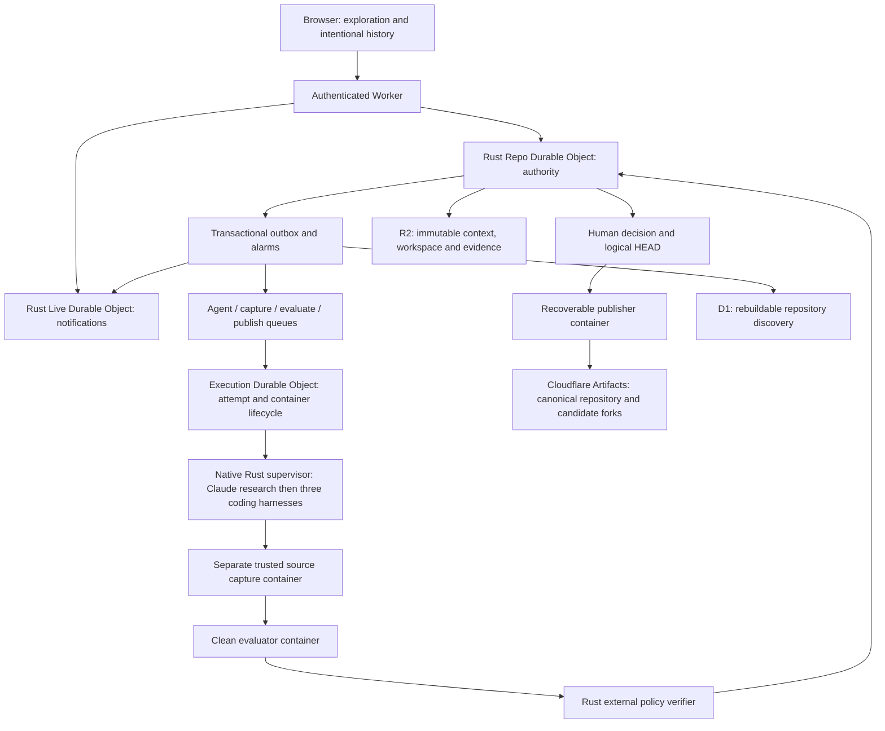

# Architecture

## Authority and storage

A repository is the unit of serialization. Its SQLite-backed DO owns intent, runs, executions, jobs, graph entities, evaluations, human decisions, logical HEAD and the publication reservation. Each command runs synchronously inside `transactionSync`; no external I/O occurs there. Events and the outbox are written in the same transaction. Alarms recover leases and drain outbox entries. D1 and Live DO never authorize a selection.

SQLite keeps repository transitions adjacent to their DO authority. D1 is also SQLite, but only a discovery projection here. PostgreSQL is a reasonable future global authority if cross-repository transactions become a requirement; adding it now would introduce another storage boundary into a Cloudflare-native per-repository design.

DO migrations carry numbered SQL files and checksum records. Wrangler migrations separately provision DO classes. D1 migrations are forward-only and use Wrangler's migration history. Generated Worker code, containers, local state, credentials and evidence exports are ignored by Git.

## Execution and evidence

The fixed MVP DAG uses one Claude research execution followed by Codex minimal, Claude defensive and Codex maintainable approaches. All receive identical frozen research artifact IDs. `provided_to` records delivery; `retrieved_by` records an actual MCP read. Neither is proof of causal influence. Agent-authored statements remain assertions.

Every queue job carries a versioned envelope. Claiming creates an epoch, bounded attempt deadline and renewable lease. All callbacks and broker operations recheck the epoch. Native supervisors send heartbeats; execution DO watchdogs destroy cancelled, completed or expired containers. Attempts use distinct container IDs. Duplicate queue delivery cannot duplicate a committed outcome.

The same native binary serves stdio MCP for both harnesses. Tools expose context, scoped artifact retrieval/publication, status and completion hints. Model arguments cannot select another tenant, repository, execution or credential.

Provider traffic leaves through allowlisted virtual host handlers. The Worker resolves Secrets Store values and injects credentials outside the container. Agents run as an unprivileged user with a cleared environment. Trusted supervisor callbacks require a separate capability unavailable to the agent process. Capture, evaluator and publisher jobs have no model capability.

Capture consumes bounded UTF-8 regular files and builds fresh Git objects in a separate container. It fetches the frozen parent, writes a new tree/commit and pushes a candidate fork. Agent `.git` state is never trusted. A clean evaluator then builds the exact captured revision offline. Candidate output is observed data; Rust policy code outside that process determines the verdict and binds it to candidate, revision, policy, suite, environment and evidence digest.

## Selection and publication

Acceptance checks exact candidate/evaluation identity, all required passing checks, current policy, expected HEAD/version, cancellation and absence of an unresolved publication. One transaction records a durable idempotency receipt, human rationale, considered alternatives, advances logical HEAD and creates the publisher outbox job.

Published HEAD remains the prior commit until the publisher verifies Artifacts. Publication checks ancestry, pushes with an explicit expected-old-ref lease and reads the ref back. A retry recognizes an already-published target after acknowledgment loss. Unexpected remote changes block publication rather than overwriting them. Starting a new run is blocked while publication is unresolved.

The history query is anchored to a captured commit and relative source path. Missing coverage is reported as unknown. Graph traversal is bounded. Incident observations preserve the original assumption and append a labelled observation; the MVP's incident inputs are simulated rather than production telemetry.
