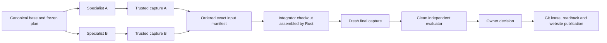

# Build together: current MVP

YonedaRepo has two frozen run modes. **Compare approaches** creates independent alternatives. **Build together** assigns complementary tasks to configured hosted agents and checks one integrated result. Existing requests without a mode retain comparison behavior.

Agents exchange typed context and exact source handoffs through scoped MCP. The console configures their plan, shows progress and evidence, allows intervention, and records the owner's final publication decision. This release accepts an explicit plan; automatic coordinator planning and local agents joining a hosted team remain later work in [the broader plan](collaborative-agent-runs-plan.md).

## Start a team

1. Sign in, create or select a repository, and save provider connections under **Agent providers**.
2. Choose **New run** or **Update website/project**, then **Build together**.
3. Configure the agent roster. Models and connections are editable; the preset does not bind a task to a particular provider. Assign at least two specialist tasks and a distinct integrator agent.
4. Define the shared interface contract, each task's instructions, dependencies and write paths, and the integrator's permitted paths. Exact filenames or directory prefixes ending in `/` are supported. Specialist scopes must be disjoint. Shared schemas and lockfiles need one designated owner.
5. Start the run. Independent ready tasks can execute concurrently; dependent tasks occupy no model container until their prerequisite source is captured. Current account/container capacity can queue otherwise ready work.
6. Inspect task source, handoff assertions, receipts and logs. After integration, review the single candidate's diff, preview and independent checks. Select it and record the publishing decision in the console.

Run policy, canonical base, roster, plan, interfaces and scopes are frozen at creation. To change the plan, start a new run. Restart and published continuation carry forward the recorded roster and team plan; updates use current canonical source.

## Source and evidence

Each task has isolated execution and capture. Runtime assembly reads only the frozen input revisions and validates their recorded Git trees. It applies each specialist's owned delta to the canonical base in a deterministic order, including additions, deletions, binary files and executable bits. Dependent captures may include ancestor files; their own scope alone is applied as a contribution. Coding export and independent capture both enforce the current task's permitted modifications.

Specialist captures are intermediate contributions. They cannot be selected or published and do not launch per-task evaluator jobs. The integrator receives every required exact output. The final capture binds its manifest digest; independent evaluation checks that precise revision under the frozen policy. Acceptance validates the current manifest and policy. Publication retains the expected-old Git lease, ancestry and readback rules.

`task_handoff` summaries and interface descriptions are agent assertions. `team_context` delivers those assertions alongside platform-captured revision records. `integration_request` gives the designated integrator the exact manifest. Successful reads produce context usage receipts under the active job/epoch identity; model-supplied identity cannot override it. Citations can link specialist context through an intermediate capture into the checked integrated revision. These records prove delivery and source inclusion; they do not prove comprehension or general product usefulness. See [context usage](context-usage.md).

## Recovery and limits

Plans support at most 16 specialist tasks plus integration, using the configurable roster of up to six agents. An agent may own several sequential tasks. Current team delegation is the explicit DAG; the compare mode's alternative-producing `delegate_agent` is disabled for team tasks.

An owner can retry a failed task, up to three task revisions, when no transitive dependent has started. Retry fences prior epochs and retains shared provider/model accounting. Completed unrelated outputs stay recorded. Active parallel work remains cancellable even if another task fails. Once a dependent starts, changing its inputs requires a new run. Cancelling stops active attempts and prevents late output from becoming authoritative.

Cloudflare Worker logs now correlate container stop requests, platform stop observations, SDK inactivity and process exit/signal metadata with job IDs and epochs. Explicitly allowlisted fields exclude credentials and raw job/provider payloads. These observations help diagnose future interruptions; they cannot retrospectively identify an old exit 143 without its lifecycle evidence.

## Implementation boundary

Rust core validates the plan. Repo DO SQLite migration **8** stores tasks and handoffs; transactional state, graph, events and outbox drive scheduling and recovery. The native runtime owns source assembly, prompts, scope checks and Git capture. Worker adapters transport scoped MCP and immutable Artifacts source. The browser projects this state and submits owner commands.

Old ledger/image versions are refused before collaborative inference. Deployment applies the append-only DO SQL migration lazily when repositories open. Runtime image rollout must finish before a paid acceptance run; no inference result is claimed by ordinary local tests.

See [dated integration and live verification](team-integration-verification.md) for the combined gates, real complementary provider work, captured handoff receipts, publication readback and observed limitations.
