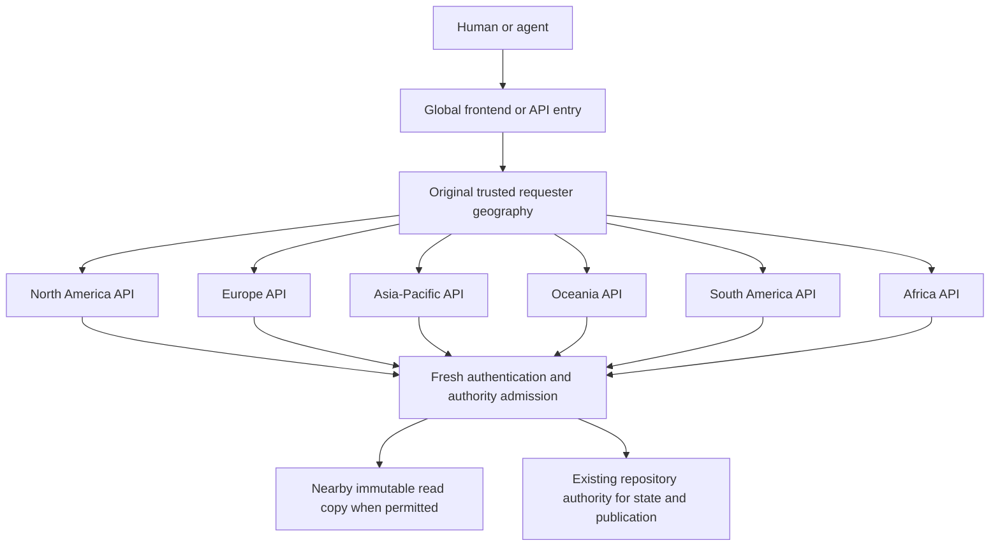

# Explicit regional API execution

Status: source implementation and integration validation. Not deployed or proven
worldwide yet. This supersedes Smart Placement as the region-selection design.

## Request path

The frontend and public API entry remain unplaced. Cloudflare runs and scales
them near incoming requests. Our code maps the original `Request.cf.continent`
to one of six API destinations; their placement references are explicit in
`infra/envs/{dev,prod}.json`. These provider region names configure Cloudflare
placement; this creates no separate AWS servers.

Each API destination has a configured `API_REGION`. Its `CELL` still identifies
which authority/resource bindings it uses. These fields have different meanings.
An API serving an existing repository may need a further authority hop; that
cannot be inferred from the caller's location or from a legacy `region` field.

New unrestricted repository objects use the creator's original geography as a
first-placement hint. Existing authority IDs, Git history, account locations and
storage identities remain unchanged. EU-selected repository namespaces retain
their jurisdiction and European hint, including when their creator travels.

## Resource ownership

The spec generates six API execution Workers per environment. They bind to
existing authority namespaces, workflow definitions, buckets, databases and queue
producers. They own no duplicate Durable Objects, workflows, container apps,
queue consumers, cron jobs or frontend assets.

Read-copy stores are created on demand. Their forward-only schema migration
extends valid region codes while preserving stored objects, blocked IDs, epochs
and seals. Quarantine/deletion fencing still visits every enrolled region.
New EU copy enrollment outside the European copy region is refused. Historical
foreign copies are not retroactively erased by this implementation.

API execution coverage is not universal data residency. Location hints are best
effort; Cloudflare currently places South America/Africa Durable Object hints in
supported nearby regions. Existing D1/R2 authorities remain the configured
US/Europe resources. Actual caller, execution and object locations need distinct
receipts. A real Asian-human placement check remains deferred by the owner.

## Routing and safety

- Only trusted runtime geography selects a region. Request headers, home cookies
  and JSON fields cannot choose the API execution destination.
- Unknown geography uses the declared North America default. A known region
  missing its binding returns an unavailable response instead of a silent fallback.
- Regional handlers skip entry dispatch. Authority forwarding uses a handler with
  an execution identity; an unexpected redispatch is refused. Its hop marker can
  only deny another dispatch, never grant access or choose a destination.
- Original metadata and credentials survive streamed uploads and reconstructed
  managed-agent requests. Agent token/background calls do not invent human geography.
- `x-yoneda-entry-region` reports the selected API destination;
  `x-yoneda-api-region` reports the final serving handler. Neither proves physical
  execution. Provider placement headers and location probes are separate evidence.
- Health and internal SSH requests stay local; named RPC methods keep their
  existing authority bindings. The shared sign-in counter and its key are unchanged.
- New-account projection remains in its selected authority cell. Frontend provider
  sign-in starts fresh account objects with the original creator-location hint.

`REGIONAL_API` controls rollout. The initial staged deployment disables dispatch
until aliases and bindings exist. Provider code must understand the read-copy
schema before new regions enroll. A routing rollback keeps that migration-aware
code; deploying an older copy-store binary is not a safe rollback procedure.

## Evidence to collect

Use [the request budget](global-api-routing-budget.md) for local gates and live
receipts. Chained workerd tests exercise regional entry, opposite-cell account
forwarding, signup and miswired bindings, in addition to region-selection tests.
They establish application behavior, not provider geography or global latency.

Retain three-run page/region timings, revision and actual placement diagnostics,
plus three dedicated 1000-writer runs. Keep original geography separate from the
physical location of a relay Worker. Publish dated figures only after validation.

References: [Cloudflare placement](https://developers.cloudflare.com/workers/configuration/placement/),
[Durable Object location](https://developers.cloudflare.com/durable-objects/reference/data-location/).
