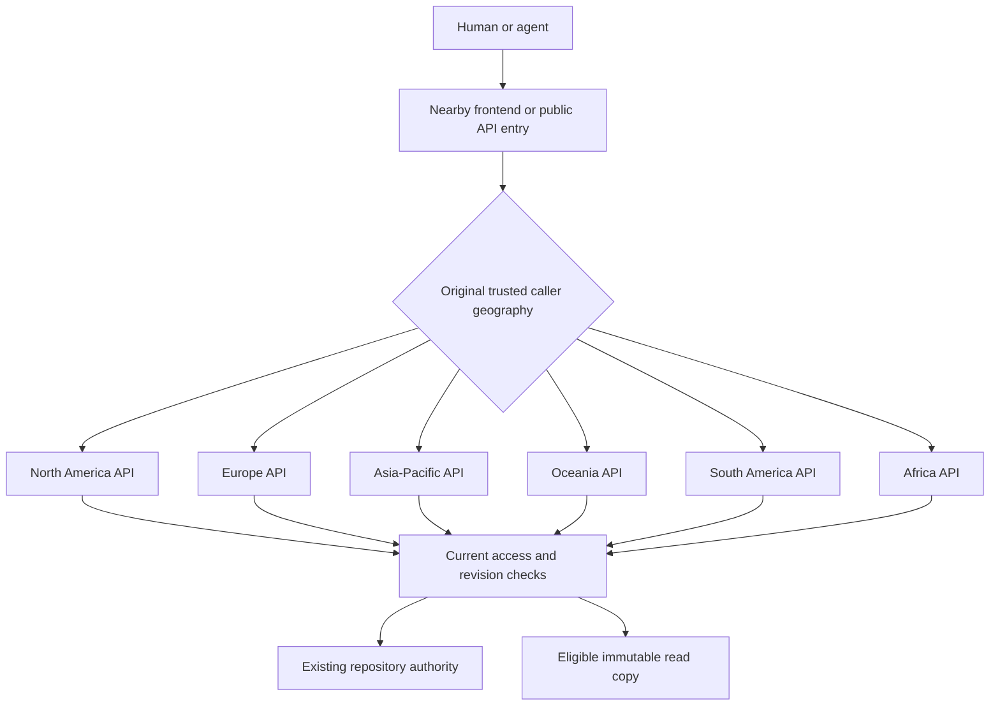

# Global API routing: dev validation

Source under validation: `c8d6d9ae9d93efa040059d54859b1791a623e862`.
Production has not been promoted. This report separates configured routing,
observed execution and repository authority placement.

## Deployed topology

The public entries have no execution pin. Each API destination has an explicit
execution identity and provider placement hint. These are six compute regions,
not six independent copies of every account or repository. The existing default
and EU authority namespaces retain their identities and storage bindings.

New repository initialization uses the original creator's location. Existing
repository authorities stay where they were created. Eligible immutable reads
can use nearby copies after current admission checks. Region selection adds no
SQL, discovery request or management API call.

EU authority forwarding remains separate from API execution selection. A request
addressed to an Asian API can still be served by the EU authority handler. The
response records the selected entry and actual serving API separately.

## Completed checks

The local deployment completed successfully, including its deployment smoke.
All six regional API health endpoints, the frontend and the public API report
the source revision above. Development and production configurations derive
from the same environment contract; production is not deployment evidence.

The shared authentication counter was exercised with one fresh synthetic key
across the public API and all six aliases. Thirty requests were allowed and the
next seven were denied, in 25,236 ms. No real account or client IP was used as
the counter key. This also checks shared credential compatibility without
reading or exposing remote credential values.

Two dedicated private repositories were created and retained. Both selected
the North America placement hint and passed three location/readback samples.
The regional test clients executed in US East and Frankfurt, but both reported
the original caller country as US. Neither result establishes a European
creator: execution location must not replace original caller geography.

The read-only matrix passed with 101 direct responses and 48 location samples.
The current HTTP and Chrome client both reported US; the public frontend and
API selected North America. Three samples per regional destination observed:

| API destination | Observed execution | Existing repository authority |
|---|---|---|
| North America | IAD | IAD |
| Europe | FRA | IAD |
| Asia-Pacific | SIN | IAD |
| Oceania | SYD | IAD |
| South America | GRU | IAD |
| Africa | CPT | IAD |

The independent EU repository continued forwarding to its EU handler. Both
repositories retained their refs, version, history chain and object store.
Versions returned 50 rows per page, covering 503–454, 453–404 and 403–354.
The served UI loaded older pages and selected revision 503 without the former
500-row request. No browser runtime errors were observed in that bounded smoke.

## Loading result

The speed goal is not met. Three fresh browser contexts each measured a first
Overview navigation, reload and repeat navigation. Three separate contexts
measured Agents cards. All values below are milliseconds:

| View | Minimum | Median | Maximum |
|---|---:|---:|---:|
| Overview, fresh context | 1,049 | 1,383 | 2,226 |
| Overview, reload | 538 | 584 | 612 |
| Overview, repeat | 494 | 562 | 762 |
| Agents cards | 1,123 | 1,279 | 1,319 |

These runs were slower than the earlier dated regional-placement measurements
for fresh/repeat Overview and Agents. HTML first-byte time and the gap between
server timing and browser wall time also rose. Earlier evidence has no complete
asset waterfall or matching caller-location observation, so this is not a
controlled code-only comparison. The current entry script, runtime module and
CSS start concurrently; no new serial import chain was found. A cached 416-byte
script still took 105–126 ms, and warm no-domain-work frontend health requests
took 103–131 ms. Those probes establish a transport floor on this connection.

The approximately 333 KB compressed application entry also delays initial
session discovery. Starting that request earlier could overlap some Agents
waiting; it would not by itself start Overview's independent resolver sooner.
No speculative startup refactor was deployed in this routing change.
Functional routing success is not worldwide performance acceptance.

## Concurrent writers

Three independent runs each used 1,000 temporary token writers on a new retained
fixture. All 3,000 commits, landings and exact-content readbacks passed across
the runs. All temporary writer tokens were revoked; no owner repository was
deleted, re-imported or repacked.

Client read p95 was 1,703 / 2,807 / 1,569 ms for runs 1 / 2 / 3. The across-run
minimum / median / maximum is 1,569 / 1,703 / 2,807 ms, not a pooled p95.
Correctness passed; subsecond loaded reads did not. These platform-API token
tests establish neither 3,000 simultaneous writers nor real-agent, native-Git
or production acceptance.

The [dated figure](performance/2026-11-03-global/global-routing-validation.png),
[editable SVG](performance/2026-11-03-global/global-routing-validation.svg) and
[sanitized measurements](performance/2026-11-03-global/api-routing-data.json)
preserve this result separately from the earlier placement experiment.

## Monitoring follow-up

Source `66c192ed` adds native backend execution diagnostics and independent EU
resource monitoring. It passed 131 targeted workerd cases and 68 infrastructure
cases before merging. Existing HTTP failure denominators and latency baselines
are unchanged; a forwarded request is not counted as several failed customer
requests. See [regional monitoring](regional-monitoring.md) for the remaining
customer death-point attribution limit and deployment status boundaries.

## Limits

Provider placement hints do not guarantee a particular city. API placement does
not establish local storage availability in every region or EU-only residency
for all historical data. Existing foreign copies are not automatically erased
by the new enrollment guard. A routing rollback must retain support for the
forward-only read-copy schema migration.

A real external Asian-client placement check is deferred by the owner. Browser
context creation is a browser-cache condition, not proof of a cold backend or
CDN. Timings from this connection are not worldwide performance claims.

Private receipts stay under `.local/implementation-20261103/`. No credentials,
account identifiers or retained repository identifiers belong in public logs.
