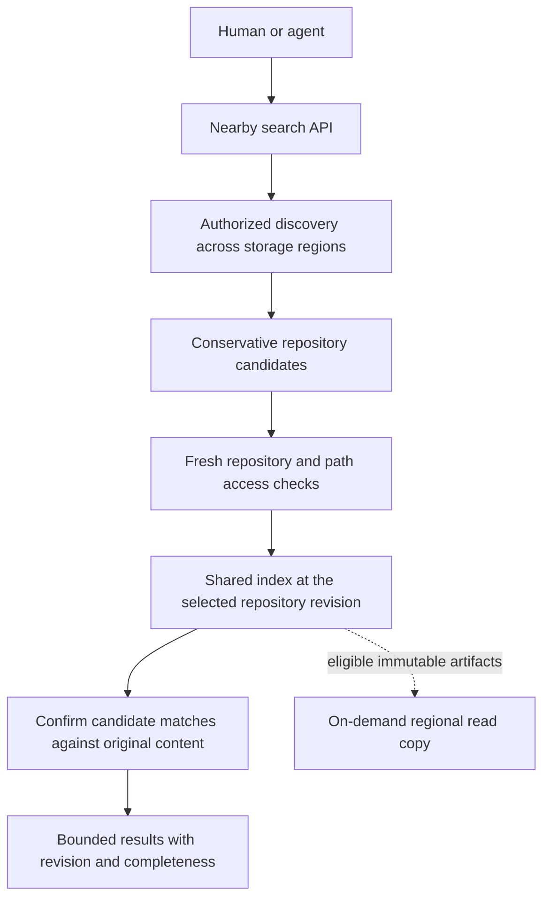

# Global search and regional indexes

Status: proposed work, 2026-11-03. This document authorizes no rollout.
Source audit: `5bb293ee`. No indexing implementation changes accompany it.

## Decision

Use shared repository indexes, a federated discovery directory, and personal
search filtered by current access. Do not build a code index for each user or
one worldwide corpus containing every private repository.

Much of this foundation already exists. The next work improves its build
coverage, freshness and regional reads rather than replacing the search engine.
First establish the [controlled performance baseline](regional-performance-baseline-plan.md).

“Global” describes the search entry and authorized discovery scope. It does not
require every private index or directory row to be stored in one global database.
The six API execution regions currently share two authority/storage cells.
Adding API Workers alone does not create six local index or object stores.

## Existing implementation

| Layer | Present behavior | Preserve |
|---|---|---|
| Repository code index | Rust trigram postings, persisted as compressed `YSG1` segments in R2 | Subtree-content reuse across revisions, branches and renames |
| Record search | Repository SQLite FTS5 for commit/path text, sessions and changes | Current access, path and quarantine filtering |
| Candidate directory | `ACCOUNT_SEARCH` stores one rebuildable summary per repository in its owner's directory | Missing, stale or saturated summaries remain “maybe” |
| Public discovery | Regional D1 public-repository metadata listings | Private repositories remain outside anonymous discovery |
| Exact-query reuse | Bounded completed-result memo for immutable code matches | Fresh admission; no cached authorization or mutable record results |
| Nearby Git reads | Eligible immutable Git object copies | These do not currently copy search-index segments |

Relevant code:

- [Rust indexing](../backend/crates/yoneda-core/src/search.rs) and
  [stored format](../backend/crates/yoneda-core/src/search/stored.rs).
- [Segment storage](../cloudflare/worker/repo-search-index.ts),
  [candidate confirmation](../cloudflare/worker/repo-search-code.ts) and
  [completed-query memo](../cloudflare/worker/repo-search-memo.ts).
- [Account search](../cloudflare/worker/repo-account-search.ts),
  [directory adapter](../cloudflare/worker/repo-search-directory.ts) and
  [derive jobs](../cloudflare/worker/repo-derived.ts).
- [Record search](../backend/crates/yoneda-platform/src/repo_store/search_records.rs)
  and [FTS migration](../backend/crates/yoneda-platform/src/migrations/repo_store/0042_search_text.sql).

Current code confirmation can read up to 1,000 candidate files in waves of 128.
Account search can combine 25 code candidates with 25 recent record candidates
per storage cell, with four repository queries running at once. It can first
read five D1 pages and 16 owner directories. The existing 20-second query-stage
deadline is not a bound on the complete listing/directory/search request.
These are current limits, not proposed latency targets.

## Ownership and consistency

**Repository authority.** Refs, membership, grants, quarantine and accepted
transitions remain authoritative in the existing repository/account objects.
Indexes are rebuildable derived data and never approve access or land a change.

**Directory.** Keep a small logical directory across the existing regional
discovery stores. Its job is locating authorized repositories and selecting
candidates. Store no snippets, source text or content-derived postings in a
worldwide directory. Reuse existing owner/org records rather than creating an
additional authoritative directory. Anonymous discovery remains public-only.

**Repository index.** Index a selected immutable tree once and share it among
authorized readers. Reuse unchanged content partitions after a one-file edit.
The index manifest identifies repository, object store, history chain, selected
commit/tree, quarantine epoch and format version. Include completeness and
references to content-validated immutable segment objects.
Keep reusable segment keys content-based within the repository/store/epoch
scope; do not add every commit ID to those keys and duplicate unchanged data.

**Personal search.** The user, organization, PAT allowlist and path grants define
which shared indexes may be queried. Do not duplicate code postings for every
member. Different principals must not share a result with a broader path scope.
Code results identify their immutable revision. Mutable record/memory groups
retain their own freshness rules; do not present them as one atomic Git snapshot.

**Regional copy.** Populate eligible immutable segments on demand near readers,
within permitted storage boundaries. Do not replicate all repositories to all
six regions. A segment copy is distinct from the repository write authority and
from enterprise backup. It does not introduce a region picker.

## Build and publication

1. Keep derivation asynchronous after accepted state transitions. Add bounded
   coverage after successful import and creation with files. Do not block a
   repository page or return success before the repository itself is usable.
   Build the default branch first; request other revisions on demand. Do not
   prebuild the entire Git history or every branch when importing a repository.
2. Capture an exact build identity from authoritative state. Queue jobs carry
   that identity and an idempotency key; they do not resolve moving HEAD later.
3. Reuse matching partitions and build only missing ones. Store chunks before
   publishing a complete manifest. Distinguish ready, pending, partial and failed.
4. Publish the ready pointer with the expected history/epoch/revision. A delayed
   job must not replace a newer pointer or revive reset/quarantined content.
5. Update the owner directory from the accepted manifest. A negative candidate
   filter is usable only when its content generation covers the requested
   snapshot. Wall-clock age or a projected activity timestamp alone is not proof.
6. Retry recoverable work through the existing queue/outbox mechanisms. Partial
   uploads are not ready indexes. No network I/O occurs inside SQL transactions.

Preserve pristine-fork de-duplication: new forks already have a special directory
marker. Do not treat that intentional behavior as a missing-index defect.
Direct fork search and forks with later activity must retain correct behavior.

Rust owns build identity, publication/fence rules, matching and pure validation.
TypeScript remains the adapter for R2, Queues and other required SDK operations.
Any SQL change uses a new forward-only migration. Do not edit applied schemas.

### Cross-repository freshness contract

A queued manifest and a lagging D1 row cannot prove that a repository has had no
new writes. Do not hide one fresh authority lookup per repository behind a claim
that directory filtering is free or that a timestamp proves current HEAD.

The proposed account-search contract is an explicitly indexed view: return the
indexed code revision and distinguish covered, delayed and unknown coverage.
It must not claim completeness at every repository's current HEAD. Explicit
repository/revision searches remain exact; a missing matching index returns
bounded recovery or partial/unavailable state rather than old results labeled
as the requested revision. Known newer revisions supplied by a writer/client
must override a stale negative directory filter.

If complete current-HEAD account search is required, measure authoritative
generation checks or design a proven catalogue watermark protocol first.
Account for their real calls and write-path cost. Do not introduce a synchronous
worldwide catalogue coordinator merely to make a freshness assertion true.
Resolve this contract in slice 1 before changing candidate exclusion behavior.

## Query and request budget

The following are proposed implementation constraints, not measured results:

| Work | Planned bound |
|---|---|
| Index construction on a page/search request | No unbounded complete build; reuse ready segments or return explicit incompleteness with bounded recovery |
| Repository fanout | Four queries concurrently across the whole aggregate request, rather than four independently per cell |
| Candidate selection | One explicit global work budget including listing, directories and confirmation; cursors continue later work |
| Immutable cache | Bounded completed values only, keyed by full content/schema/epoch identity |
| Mutable state | Fresh admission and selected-revision validation; no shared pending authorization request |
| Cancellation | Stop unsent work and cancel owned reads; mutations and other callers' requests are unaffected |

Choose numerical wall-time and byte limits from the baseline before coding.
Do not obtain a fast result by silently truncating coverage or reporting a
partial search as complete. Use a completeness/cursor contract for bounded work.
Short queries that cannot use trigrams must retain an honest bounded fallback.

Record separate timings for discovery, admission, manifest/segment reads,
candidate blob reads, exact confirmation, ranking and response transfer. Count
cross-region calls and bytes. Measure distinct queries separately from exact
memo hits. A query-result cache hit is not evidence of a fast underlying index.

## Regional artifact path

The existing nearby Git-object cache cannot accept arbitrary search segments by
pretending they are Git blobs. Introduce a typed derived-artifact contract only
if measurements justify the regional copy work:

- Repository/store identity, artifact kind, content digest, schema and epoch
  must be checked before publishing or serving a copy.
- Current admission and quarantine/purge fencing apply on every request.
  A cached segment never carries an authorization decision.
- Bound enrollment, segment bytes and total copy storage. Deduplicate content
  within its permitted scope; do not deduplicate private tenants by guesswork.
- EU-controlled artifacts stay within their allowed jurisdiction. Historical
  foreign copies require a separate inventory and cleanup; the guard does not
  establish repatriation or blanket GDPR compliance.
- Missing, stale or corrupt copies fall back safely. They never become write
  authorities or return plausible but incomplete results as complete.

## Implementation order and acceptance

| Slice | Concrete result | Required evidence |
|---|---|---|
| 1. Baseline and spans | Reproducible same-client search/page traces and complete request budget | Controlled paired runs; source, data placement, cache and index states recorded |
| 2. Background coverage | Imports and populated creation enqueue bounded builds with generation fencing | Interrupted/replayed jobs, stale publication, resets and unchanged partition reuse |
| 3. Query cost | Reduce measured segment and candidate-content reads before increasing fanout | Distinct-query comparison, complete match equivalence, bytes/call counts and cancellation |
| 4. Regional derived copies | Content-validated, fenced copies where a measured distance penalty remains | Real regional reads, purge/revocation races and jurisdiction tests |
| 5. Directory work | Tighten aggregate paging/fanout only where directory work is measured hot | Personal/org/PAT/path scope isolation, no false negative from lagging summaries |

Put new paths behind separate switches with off-path compatibility. Derive dev
and prod configuration from the same spec. Begin with targeted failing tests,
native Rust tests and real workerd storage/queue tests. Validate the served UI
without changing its layout for this backend work.

Acceptance includes one build independent of authorized reader count; reuse after
a one-file edit; correct selected revision; no stale reset/quarantine content;
and enforcement of removed membership/PAT/path scope within the existing access
revocation bound. Missing or failed
indexing remains visible as partial/unavailable rather than an empty success.
Use the required three measured dev runs and final 1,000-writer acceptance before
claiming a performance improvement. Preserve retained test repositories.

No new model-based indexer, agent scheduler, separate per-user corpus, automatic
worldwide private replication or public-wide code crawler belongs in this work.
Current account search covers owned/shared repositories; extending search across
all public repositories is a separate product decision.
