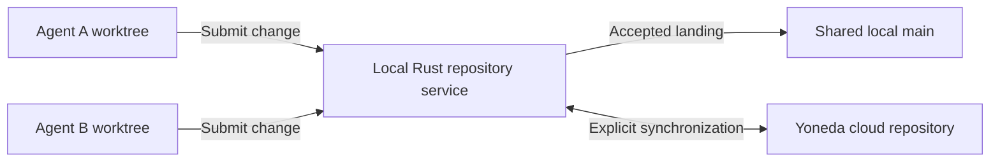

# Future feature: local Rust repository service

Status: proposed, 2026-11-03. Documentation only; implementation is not authorized.
This is separate from the current loading, release and demo work.

## Intended outcome

A cloned project could run the same Rust repository engine locally. Multiple
agents would work in isolated worktrees and submit changes to one shared local
`main`. The repository would retain real Git objects and normal Git tools.

`yoneda clone` already invokes real Git through the Yoneda remote helper. The
future addition would be a persistent local repository service shared by that
clone's worktree family. Independent clones would remain independent unless
explicitly connected to the same authority.

## Proposed behavior

- Each agent keeps its own working files, index and base revision. Updating the
  shared target must never overwrite another worktree's unfinished edits.
- Editing, diffs and local commits remain Git operations. Publication to the
  shared target goes through the repository service and its landing rules.
- Agents prepare changes concurrently. The service orders accepted updates to
  `main`, merges compatible changes and reports conflicts requiring resolution.
- Checks and approvals apply to the exact resulting revision. A successful text
  merge alone does not establish that the combined program works.
- Each accepted operation has a durable receipt. Retrying after a lost response
  must not duplicate a landing; restarting must recover the recorded state.
- Local acceptance and cloud publication are separate outcomes. Synchronization
  must handle a cloud head that advanced independently, current permissions and
  cloud policy. A local check or approval does not automatically satisfy a cloud
  requirement after the revision changes.

All agents may target the same logical `main`; this does not require checking out
the same mutable branch in every Git worktree. Branches or detached worktree
heads and their refresh behavior remain design decisions. Normal Git pushes must
keep clear, documented semantics; direct ref writes cannot be treated as an
accepted Yoneda landing merely because a file changed on disk.

## Existing foundation

- [Rust platform engine](../backend/crates/yoneda-platform/src/lib.rs): repository
  contracts, transactions, refs, landing and the ordered log.
- [Store interface](../backend/crates/yoneda-store/src/lib.rs) and
  [native SQLite adapter](../backend/crates/yoneda-store/src/native.rs): the
  existing platform already runs against a native database in local tests/tools.
- [Clone command](../backend/crates/yoneda-cli/src/clone.rs) and
  [Git remote helper](../backend/crates/yoneda-cli/src/remote/mod.rs): existing
  Git-facing client integration.

Reuse these contracts and migrations through a native hosting/storage adapter.
No claim is made that the existing adapter already supplies a production local
service, recovery system or offline cloud synchronization.

## Design questions before implementation

1. How is local mode selected, and where does its repository identity live?
2. How does one process own publication, prevent competing service instances and
   recover after crashes? Which objects and filesystem changes must be durable
   before a database transaction can acknowledge acceptance?
3. How are Git refs exposed or rebuilt from accepted state after an interrupted
   update, without conflicting filesystem and database authorities?
4. Does the remote helper use a local socket or a loopback API? How are callers
   scoped, credentials protected and repository paths constrained?
5. When does synchronization occur, and how are offline changes reconciled with
   an independently updated cloud repository? How are conflicts and pending cloud
   publication shown without implying that local work is already published?
6. Which existing check and policy capabilities are available locally, and which
   require a cloud service? Missing capabilities must remain explicit.

The service coordinates repository state. Agents remain external clients; this
proposal does not add planners, model execution or agent scheduling to the
platform. Local coordination, durability and Git compatibility need acceptance
evidence before any performance or scale claims.

## Future acceptance criteria

Use small imported or dedicated demo repositories, preserving owner fixtures.

- Two stock agents in isolated worktrees start at the same base, edit different
  files and both land successfully without lost changes.
- Overlapping edits fail clearly, preserve both proposals and leave the accepted
  `main` unchanged until a resolution is admitted.
- Checks run against the exact combined revision; a stale approval cannot accept
  a different revision.
- Killing the service around persistence and acknowledgment, then retrying,
  produces one recoverable outcome with no duplicate landing or missing objects.
- Git status, diff, log, fetch, clone and publication behavior are verified with
  real Git, including worktree isolation and interrupted publication.
- Offline work survives restart; later synchronization handles a changed cloud
  head and revoked access without overwriting remote work or claiming success.
- Latency and concurrent-writer behavior are measured independently of cloud
  results. Current cloud benchmarks do not prove native service performance.

Reference: [Git worktrees](https://git-scm.com/docs/git-worktree) and
[Git remote helpers](https://git-scm.com/docs/gitremote-helpers).
