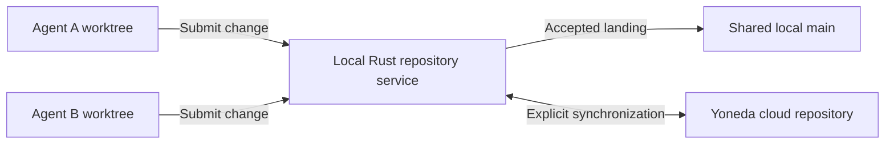

# Future feature: local Rust repository service

Status: implemented locally; configurable integration branch added 2026-11-06.
This repository uses **task branches → local/dev → dev → release PR → main**.
`yoneda local configure --branch dev --no-cloud` selects development landing
without automatic cloud publication. See [the runbook](runbook.md)
for commands. Existing installations default to `main`; the original design
below uses that name for the shared integration branch.

## Intended outcome

A cloned project could run the same Rust repository engine locally. Multiple
agents would work in isolated worktrees and submit changes to one shared local
`main`. The repository would retain real Git objects and normal Git tools.

`yoneda clone` already invokes real Git through the Yoneda remote helper. The
future addition would be a persistent local repository service shared by that
clone's worktree family. Independent clones would remain independent unless
explicitly connected to the same authority.

Local and cloud hosting should share the same Rust transaction rules, migrations
and acceptance contracts. Native SQLite and Cloudflare storage are hosting
adapters around that engine. A local daemon should not maintain a second set of
publication or conflict rules.

Concurrent writers can move a shared checkout's `HEAD` during validation, even
when every individual merge is valid. Each validation must name an immutable
captured revision. Publication must compare its expected target revision, then
validate any combined result before accepting it. Unrelated agents should not
need to freeze their work to preserve another agent's baseline.

## Proposed behavior

- Each agent keeps its own working files, index and base revision. Updating the
  shared target must never overwrite another worktree's unfinished edits.
- Editing, diffs and local commits remain Git operations. Publication to the
  shared target goes through the repository service and its landing rules.
- Agents prepare changes concurrently. The service orders accepted updates to
  `main`, merges compatible changes and reports conflicts requiring resolution.
- Checks and approvals apply to the exact resulting revision. A successful text
  merge alone does not establish that the combined program works.
- Each accepted operation has a durable receipt. Retrying after a lost response
  must not duplicate a landing; restarting must recover the recorded state.
- Local acceptance and cloud publication are separate outcomes. Synchronization
  must handle a cloud head that advanced independently, current permissions and
  cloud policy. A local check or approval does not automatically satisfy a cloud
  requirement after the revision changes.

All agents may target the same logical `main`; this does not require checking out
the same mutable branch in every Git worktree. Branches or detached worktree
heads and their refresh behavior remain design decisions. Normal Git pushes must
keep clear, documented semantics; direct ref writes cannot be treated as an
accepted Yoneda landing merely because a file changed on disk.

## Existing foundation

- [Rust platform engine](../backend/crates/yoneda-platform/src/lib.rs): repository
  contracts, transactions, refs, landing and the ordered log.
- [Store interface](../backend/crates/yoneda-store/src/lib.rs) and
  [native SQLite adapter](../backend/crates/yoneda-store/src/native.rs): the
  existing platform already runs against a native database in local tests/tools.
- [Clone command](../backend/crates/yoneda-cli/src/clone.rs) and
  [Git remote helper](../backend/crates/yoneda-cli/src/remote/mod.rs): existing
  Git-facing client integration.

Reuse these contracts and migrations through a native hosting/storage adapter.
No claim is made that the existing adapter already supplies a production local
service, recovery system or offline cloud synchronization.

## Design questions before implementation

1. How is local mode selected, and where does its repository identity live?
2. How does one process own publication, prevent competing service instances and
   recover after crashes? Which objects and filesystem changes must be durable
   before a database transaction can acknowledge acceptance?
3. How are Git refs exposed or rebuilt from accepted state after an interrupted
   update, without conflicting filesystem and database authorities?
4. Does the remote helper use a local socket or a loopback API? How are callers
   scoped, credentials protected and repository paths constrained?
5. When does synchronization occur, and how are offline changes reconciled with
   an independently updated cloud repository? How are conflicts and pending cloud
   publication shown without implying that local work is already published?
6. Which existing check and policy capabilities are available locally, and which
   require a cloud service? Missing capabilities must remain explicit.

## Design answers (2026-11-04)

The service is `yoneda-local`, a loopback Git smart-HTTP server whose push path
is the cloud's Rust push path (`ReceiveSession`, `repo_record_pushed`, landing).

1. **Mode and identity.** `yoneda local init` in a clone creates
   `.git/yoneda/local/` (shared by its worktrees): a bare object store
   `store.git`, the authority `authority.sqlite`, `sync.sqlite`, a token and a
   fixed port. It adds the remote `local` at
   `http://127.0.0.1:<port>/git/<repo-id>.git`; the repository id is the paired
   cloud repository's. Pairing: the clone's yoneda remote, or else a new cloud
   repository with `main`'s history pushed to it.
2. **One owner, durability.** `yoneda local serve` takes an exclusive lock;
   a second instance refuses. One thread owns the SQLite authority (WAL,
   `synchronous=FULL`) and runs every command through `execute_migrated`.
   Pushed objects are written to `store.git` and fsynced
   (`core.fsync=objects,reference`) before the authority records them; a push
   is answered only after its transaction commits. Retries are content-addressed
   and `repo_land` answers `already`.
3. **Refs.** The authority is the truth. After each commit, refs in `store.git`
   are moved with `git update-ref <ref> <new> <old>`. On start the service drains
   pending objects and reconciles refs, and refuses to overwrite a ref changed
   outside it.
4. **Transport and callers.** Loopback HTTP, so stock Git, worktrees on the host
   and clones in the Docker sandbox all use it. Callers need a token, given to
   Git by a credential helper, never in arguments or URLs. Principals:
   `local:<user>` on the host, `local-agent:<name>` in the sandbox.
5. **Sync.** Automatic. Up after each local landing on `main`: a smart-HTTP push
   of the tip with the union of the unsynced landings' read sets, so commit ids
   stay the same. Down every 30 s: cloud `main` is fetched and landed locally
   (fast-forward or a local platform merge). States shown by
   `yoneda local status`: `synced`, `pending`, `conflict`, `diverged`,
   `refused`, `offline`. Local acceptance and cloud publication are shown
   separately; a local landing is never rolled back.
6. **Capabilities.** Locally: landing, OCC, declared reads, merges, the log and
   reads at a version, and the owner's local checks (`yoneda local check`, below)
   on the revision that lands. No approvals locally. Cloud policy, checks and
   approvals apply when the work lands in the cloud.

Built so far (2026-11-04, `backend/crates/yoneda-local`, answers 1–4 and 6):
`init`, `serve`, `status`, the credential helper, the receive path, landing and
ref projection; `cargo test -p yoneda-local` covers disjoint and conflicting
pushes, a stale declared read, a crash before the answer and before the ref
update, the single-instance lock and a refused token. Where it differs from the
plan above:

- A landing that needs a merge is merged and landed directly (`repo_merge_plan`,
  then `repo_land` with `merge`), not queued for a combiner; both are the
  engine's paths and the authority verifies the merge either way. The host holds
  a lock across those steps so no other landing moves the head in between.
- Pushed packs are verified, then written to the store before they are recorded.
  The platform's own merge commits are staged in the authority and drained into
  the store after the landing (since 2026-11-06; before, a receive-pack request
  under a hidden ref, still used with `YONEDA_LOCAL_STAGE=off`).
- Fetch is Git's own `git http-backend` over the store.
- The token is an engine repository token (`token:local`, read, write and land),
  so the engine authenticates every request; per-agent tokens are the same
  mechanism.

Cloud sync (answer 5), built 2026-11-04 (`src/sync/`, `src/cloud.rs`):

- Pairing happens in `init` (and in any later round until it succeeds): the clone's
  yoneda remote, including one by name, else a private repository created on the
  signed-in origin. Its id is recorded before anything is pushed; `main`'s history is
  pushed over smart HTTP with the same commit ids; then the local repository takes
  the cloud id (its config and the remote `local`; the running service reads it per
  request). There is no built-in default origin: without a login it is `unpaired`.
- A round: down (cloud `main` fetched into the store and landed through the receive
  path as sync's own repository token `cloud-sync`), up (a stock push of local `main`
  with `-o yoneda.reads=` holding the union of the unsynced landings' read sets, at
  most 1,000 paths), and down again when up pushed (a cloud merge comes back as a
  fast-forward). Rounds run after each landing on `main`, every 30 s and on
  `yoneda local sync` (`POST /local/sync` with the local token when `serve` runs).
- Sync state is `sync.json`, not `sync.sqlite`: it holds the pairing and a cursor;
  everything else is read back from the cloud and the local log each round.
- Cloud Git runs clear every other credential helper and use
  `yoneda-local credential cloud`, which answers only the origin sync names.

Verified 2026-11-04: `cargo test -p yoneda-local` runs plan tests 8–12 against a
second local service standing in for the cloud, and an unpaired init; the same
8–12 plus 13 (init creates and fills a cloud repository) passed against
dev.yonedarepo.com (`--test sync -- --ignored`). Test 11 on dev revokes a repository
token made for the test; test 12 cuts the network with a dead `HTTPS_PROXY`.
Limits: pairing pushes `main` in one push (the cloud's 40,000-object and 64 MiB pack
limits apply); a read path containing a comma cannot be declared over the push
option.

Agents, built and run 2026-11-04 (step 6): `yoneda local token create|list|revoke`
gives each sandboxed agent its own token (`token:<name>` in `yoneda local log`);
`sync` with no service leaves `serve.pid` alone; the service also answers to the id a
repository had before pairing. Docker Desktop containers reach the 127.0.0.1-bound
service through `host.docker.internal`, so no wider bind was added. Real agents:
`node tools/staging/local-agents-run.mjs --bin <yoneda-local>`, opencode with
`zai-coding-plan/glm-5.3` (Coding Plan; opencode reported $0), two agents per scenario,
each in the sandbox with only its own stock clone mounted and the service as its only
remote. Two runs on `spf13/pflag`, paired with dev (`r09800c38c9b18db1b675`,
`r2f73312459a4d5f91d5a`); evidence `.local/staging/local-agents-1793807215667/` and
`.local/staging/local-agents-1793807373933/`:

- Disjoint files from one base: both landed (a fast-forward, then the platform's merge
  commit), both runs.
- The same README line from one base: the first push landed; the second was refused
  `! [remote rejected] HEAD -> main (conflict in README.md: run git pull)` and its branch
  stayed; `main` lost no change, both runs.
- The store passed `git fsck --strict`; dev's `main` matched local `main` (same commit
  id) with both agents' files; the second run's host check found no change to any host
  checkout or remote (the first flagged only an edit made in this worktree by the
  operator during the run).

Races, local checks and write speed, built 2026-11-06:

- **Simultaneous writers** (`tests/races.rs`): 8 linked worktrees of one clone push to
  `main` released by one barrier, and the service's own timings show every receive began
  before the first finished. Disjoint files: all 8 land (1 fast-forward, 7 platform
  merges). Different lines of one file: all 8 land and the file holds every edit. The
  same line: exactly 1 lands; the other 7 are refused `conflict in list.txt`, each
  loser's own branch kept. Half and half: 1 of the same-line half and all of the other
  half land. Each ends with `git fsck --strict` clean.
- **What the race tests found:** 1 push in 4–8 runs was refused `MERGE_REQUIRED`. The
  platform's merge commit had been turned away by the store's `receive-pack` with
  "unable to migrate objects to permanent storage": Git's default maintenance strategy
  is now geometric repacking, which `receive-pack` starts after each push whatever
  `gc.auto` says, and it raced the next push. The store now sets `receive.autogc=false`
  and `maintenance.auto=false`, and `serve` applies them to stores made earlier. Before:
  6 failing runs of 25; after: 0 of 40 (the race, checks and local tests together). A
  refused merge now logs Git's own reason. Taking the landing lock away makes the race
  tests fail too (2 runs of 3): a writer gives up after 8 attempts (`OVERLOADED`); no
  edit was lost either way, as the authority verifies every landing.
- **Local checks** (`yoneda local check`, `src/checks.rs`): the owner's commands, kept as
  the policy's command runners and run through the engine's fenced check runs, so each
  verdict is recorded against its commit, tree, file-set digest and policy digest. They
  run on what would land, while the landing lock is held: the pushed commit for a
  fast-forward, the platform's merge commit otherwise. A failure, a timeout (the process
  group is stopped by its own id) or a check that cannot run refuses the landing, with
  the output's last lines. `--on-host` or `--image <image>` (Docker, no network) is
  required: pushed code is untrusted, so sandboxed agents' work belongs in an image.
  Tested (`tests/checks.rs`): a failing check refuses a fast-forward; two pushes that each
  pass alone but fail together are refused on the merged result, which exists in no
  worktree; 4 simultaneous pushes all land checked; a 1 s timeout stops `sleep 30`; and
  (with Docker) a check in `alpine:3.22`. Removing the merge-result check makes the
  combined-revision test fail. Sync down lands cloud `main` without local checks; the
  cloud's own apply there.
- **Write speed, local only** (unpaired, so no cloud in the path; `YONEDA_LOCAL_TIMINGS`
  on): disjoint files, all writers released together, 3 runs each, Mac, debug build,
  min/median/max ms:

  | Writers | Client push | Service | Landing (incl. waiting) | Landings/s |
  |---:|---:|---:|---:|---:|
  | 1 | 108–125 | 62–74 | 0–1 | 8.0–9.2 |
  | 4 | 162 / 322–342 / 406 | 99 / 251–276 / 345 | 2 / 151–176 / 247 | 9.8–10.5 |
  | 16 | 311 / 911–970 / 1,491 | 198 / 770–827 / 1,351 | 1 / 555–570 / 1,089 | 10.7–11.2 |

  Landings on `main` are serial under the landing lock, so throughput stayed about 10 a
  second whatever the writer count. Since then (docs/local-landing-budget.md): 28.5–30.4
  a second at 16 writers, 37–40 ms for a lone push.

Acceptance criteria above: met for disjoint landing, overlap refusal with both
proposals kept, crash and retry, Git verification, offline work with a changed cloud
head and revoked access (tests 4, 8–12), simultaneous writers, checks on the combined
revision, and local latency apart from the cloud.

The service coordinates repository state. Agents remain external clients; this
proposal does not add planners, model execution or agent scheduling to the
platform. Local coordination, durability and Git compatibility need acceptance
evidence before any performance or scale claims.

## Future acceptance criteria

Use small imported or dedicated demo repositories, preserving owner fixtures.

- Two stock agents in isolated worktrees start at the same base, edit different
  files and both land successfully without lost changes.
- Overlapping edits fail clearly, preserve both proposals and leave the accepted
  `main` unchanged until a resolution is admitted.
- Checks run against the exact combined revision; a stale approval cannot accept
  a different revision.
- Killing the service around persistence and acknowledgment, then retrying,
  produces one recoverable outcome with no duplicate landing or missing objects.
- Git status, diff, log, fetch, clone and publication behavior are verified with
  real Git, including worktree isolation and interrupted publication.
- Offline work survives restart; later synchronization handles a changed cloud
  head and revoked access without overwriting remote work or claiming success.
- Latency and concurrent-writer behavior are measured independently of cloud
  results. Current cloud benchmarks do not prove native service performance.

Reference: [Git worktrees](https://git-scm.com/docs/git-worktree) and
[Git remote helpers](https://git-scm.com/docs/gitremote-helpers).
