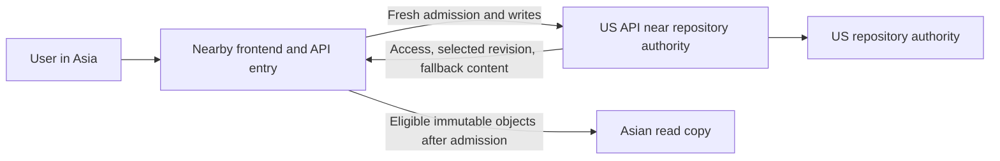

# Fast repository access after travel

Status: implementation plan. The work below is not yet implemented.

A person who creates a repository in New York should get a nearby frontend
when visiting Asia, fast access to eligible nearby content, and the same
confirmed repository state. Travel should not move the repository authority.

## Responsibilities and current behaviour

| Behaviour | Owner | Current state |
|---|---|---|
| Nearby frontend execution and Worker scaling | Cloudflare | Managed infrastructure |
| Regional API selection and access to the existing authority | Application | Implemented |
| Eligible immutable read copies | Application | Automatic, on demand |
| Travel-triggered pre-warming | Application | Proposed below |
| Fewer distant metadata round trips | Application | Partial; further bundling needed |
| Cheap cold read-copy misses | Application | Further work needed |

Cloudflare does not automatically create an Asian replica of a US Durable
Object or relocate it after travel. Location hints apply at initial placement
and are best effort. See [Cloudflare data location](https://developers.cloudflare.com/durable-objects/reference/data-location/).

Existing content copies are bounded caches, not complete repository replicas.
Permissions, current refs and writes still depend on authoritative state.
The current copy path can wait for a registry lookup and an empty copy before
falling back to object storage. A nearby frontend alone does not remove that
cost or repeated trips to a distant authority.

## Intended flow

Keep one authority ordering writes. Run distant admission work near that
authority and serve immutable content from eligible nearby copies. A permanent
repository relocation is separate work, not a login or travel side effect.

Routing and cached metadata are hints. They must not grant access, choose an
unconfirmed revision, or override the repository's residency policy.

## 1. Make cold misses cheaper

Start here before adding background pre-warming traffic.

- Add a backward-compatible `newly_enrolled` field to the read-copy permit.
  Derive it from the existing transactional region enrollment, without an
  additional SQL statement or network call.
- For literal `newly_enrolled === true` **and `epoch === 1`**, skip the
  foreground `copy_get` and use the existing authorized object-storage path.
  Keep the normal bounded fill afterwards.
- Missing/false fields and higher epochs retain the existing path. Higher
  epochs need the existing fence recovery before a fresh store accepts fills.
- Enrollment does not prove an object is currently absent: another request
  can fill it concurrently. Choosing the source remains correct; the potential
  loss is a cache hit, not correctness.

This candidate saves one lookup on the qualifying path. It does not fix every
miss or prove a particular latency saving. Existing-region cold starts still
need measurement.

A later hedge may start source retrieval alongside a slow copy lookup. That
requires a separate budget: it can add source reads on a copy **hit**, duplicate
body memory, and leave unfinished requests. Bound size and concurrency, handle
losers explicitly, and validate costs before enabling it. Do not describe such
a race as having zero extra requests.

## 2. Bundle work near the authority

Avoid running a sequence of US metadata calls from an Asian API Worker.

1. Find the repository's preferred home through a rebuildable directory.
   Persist explicit home metadata for new repositories. Existing logical cell
   IDs and API execution regions do not prove physical object placement;
   backfill conservatively from verified metadata, outside page loading.
2. Have the nearby entry call a home-region API for one coherent read admission.
   The home API performs account and repository checks close to their data.
3. Return the selected ref, repository version, commit/tree, access and
   quarantine context, and the minimum bootstrap content needed for a miss.
   Keep this context request-scoped and bound to the authenticated principal.
4. Read local immutable objects by their validated identities. A last-known
   snapshot or bounded cache-availability hint may reduce returned bytes;
   it cannot authorize access or justify showing an old branch head.

Target one entry-to-home round trip for a known repository's core admission.
Measure cold directory discovery separately rather than hiding it in that
budget. Account and repository homes can differ; bundle each required home's
work and report those additional hops separately. The New York example can
co-locate both, but that must not become a universal latency assumption.
The number of local home-region authority calls may remain unchanged.
No network I/O belongs inside an authority's SQL transaction.

After a write, carry the confirmed version into subsequent reads. Until a
nearby copy catches up, use the authoritative result or origin content. Never
show an older copy as the successfully published state.

## 3. Pre-warm recently used repositories after travel

Use trusted original request geography, not an arbitrary client header or the
location of a forwarding Worker. Keep coarse region state rather than storing
precise travel history.

- After an authenticated session becomes active in another region, enqueue
  bounded warming for recently used repositories the person can still access.
  Do not wait for it during sign-in or navigation.
- Start with the selected snapshot, root tree, README and small eligible
  objects. Do not clone every repository, traverse full history, or prefetch
  large binaries. Search-index warming follows the separate indexing plan.
- Revalidate permission and residency when the job executes. Use scoped,
  expiring internal work; do not persist the person's bearer credentials.
- Deduplicate work by account/region/repository/revision, limit retries and
  cancel obsolete work. Repeated region changes must not produce a warm storm.
- Warming is optional. Missing, failed, expired or full caches must leave
  ordinary source reads usable.

Proposed initial limits, to tune against measured cost:

| Budget | Initial limit |
|---|---|
| Foreground requests waiting for warming | 0 |
| Recently used repositories per travel event | 3 |
| Concurrent warm jobs per account | 1 |
| Objects / bytes per job | 16 objects / 4 MiB total |
| Individual cached object | Existing 1 MiB limit |
| Repeated event enrollment | At most once per account/region per 30 minutes |

The event interval is a proposed load-control setting, not a permission lease.
New requests must reauthorize; purge acknowledgement still waits for enrolled
copies to be fenced, and fencing must block late fills. Honour EU-only or other
configured server-side residency;
travel does not permit copying that content into a disallowed region.

## Correctness and rollout gates

Put each new path behind its own default-off switch. Keep the same immutable
object identities, authoritative write leases, selected revision, permission
checks, quarantine fences and purge acknowledgement rules.

Validate on dev with retained real-history repositories and accounts that can
be inspected through the UI. Cover:

- New York-created repository opened by a real Asian client: first visit,
  repeat visit, reload, branch/tag selection, and reads after a write.
- Another collaborator still working in the US, with correct concurrent-write
  conflict handling and no authority movement.
- Private access revoked, object quarantined/purged, stale copy, stale directory
  hint, missing copy, unavailable region, and a residency-restricted repository.
- HTTP Git and browser routing; document the separate SSH-origin gap. The
  current internal SSH path does not provide reliable client locality and must
  not infer it from the gateway's location.

Use at least three runs per condition, normal browser caching, server-side
phases and min/median/max. Separate cold and warm cache results, request/byte
costs, and observed placement from hints. Request geography simulation is not
proof of physical placement or Asian-client performance. Do not run writer
bursts for this frontend/backend latency study, or a full dev kit per change.

Enable in stages: cold-miss optimisation, bundled admission, then bounded
pre-warming. Promote only after the corresponding dev checks pass. Disabling
a switch restores origin reads; it must not delete repositories or rewrite
their authority. Keep purge/fence handling active even with read warming off.

## Code and related plans

- Routing: `cloudflare/worker/regional-api.ts`, `cell-edge.ts`, `cell-route.ts`.
- Copies: `cloudflare/worker/repo-locality.ts` and the Rust read-copy registry.
- Admission: `repo-credentials.ts`, `repo-paths.ts`, `repo-overview-admission.ts`.
- [Global scale plan](global-scale-plan.md)
- [Existing read-copy request budget](global-read-copies-budget.md)
- [Regional performance baseline plan](regional-performance-baseline-plan.md)
- [Global directory and repository search indexes](global-search-index-plan.md)
